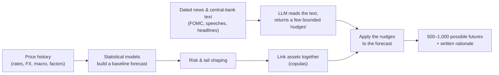
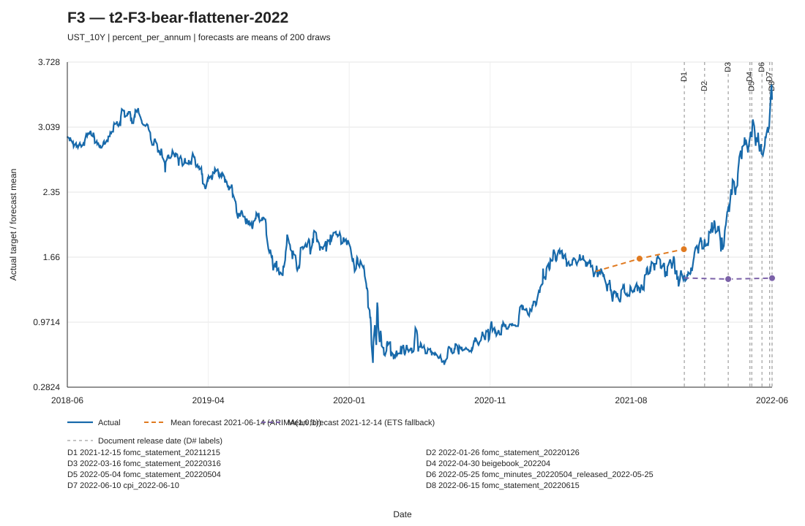

# Forecasting Markets with Numbers *and* News

**Agenthon 2026 · Track 2 (Reasoning-Augmented Forecasting) · Team Gamblr**

An AI forecasting agent that reads two things — a history of market prices and the
news written about those markets — and predicts not a single number, but **the full
range of what could happen next and how likely each outcome is**.



---

## The challenge in one minute

Most forecasting models look only at numbers. The question this competition asked was:
**can an agent that also *reads* do better?** If a central bank's statement suddenly
sounds more hawkish, a human trader adjusts their expectations before the price data
shows anything. We wanted an agent that can do the same — carefully.

For each task ("card"), the agent receives:

- **Market data** up to a cut-off date — U.S. Treasury yields, G10 currencies,
  macroeconomic releases, and equity factor returns.
- **A frozen text library** with only documents published *before* that date — no
  peeking at the future, and no internet access apart from the organizers' approved
  LLM endpoint.

It must output **hundreds of simulated future paths** (a "probabilistic forecast").
These are graded against what really happened using a score that rewards being
accurate, being honest about uncertainty, getting relationships between assets right,
and not being surprised by extreme moves. Lower score = better.

The tasks come in four flavours, and each one tests a different skill:

| Family | Plain-English question | What matters most |
|---|---|---|
| **F1** — Continuation with context | "Where does this series go next, given the latest news?" | Getting the central path right |
| **F2** — Regime shift | "Is the text warning that the rules of the game are changing?" | Spotting the turn early |
| **F3** — Cross-asset reasoning | "News hits one market — how do connected markets move together?" | Getting the *joint* behaviour right |
| **F4** — Tail shock | "Does the text hint at a crash or spike?" | Not underestimating extremes |

---

## What we built

- **A layered forecasting engine** (`my_agent_3/`, the final agent). Like an
  assembly line, each layer does one job: build a baseline forecast → reshape its
  risk → tie assets together → adjust using the news.
- **A different recipe for each task family**, chosen by testing — not guessing.
- **A safety-first LLM design.** The language model never writes forecast
  numbers. It reads the documents and returns a few *bounded* signals ("shift the
  centre slightly up", "widen the range a bit"). Code applies them, inside hard limits.
  If the LLM is unavailable or says something invalid, the agent quietly carries on
  without it.
- **Nothing is allowed to fail.** Every model has a backup, and every backup has a
  backup, ending in a simple random walk that always works. In our largest back-test
  (90 tasks, 180 forecasts), backups covered every model failure and no task was left
  without a forecast.
- **Over a dozen controlled experiments**, from choosing the trend window for F1 to
  comparing 17 ways of turning text signals into forecasts — all with charts, raw
  CSVs, and written reports.
- **A competition-ready Docker image** that runs offline, exactly as the judges'
  harness runs it.

---

## How the final agent works

Think of it as four specialists passing a forecast down the line:

| Step | Specialist | What it does, in plain words | Code |
|---|---|---|---|
| 1 | **The statistician** | Looks at the price history and simulates hundreds of plausible future paths using classic, well-understood models (ARIMA, exponential smoothing, trend-aware random walks, VAR, regime-switching). If one model fails, the next one steps in. | [`statistical_layer/`](my_agent_3/statistical_layer) |
| 2 | **The risk manager** | Adjusts how "wild" those paths are. Markets have calm and stormy periods (GARCH captures this) and crash more often than a bell curve suggests (fat tails). | [`transformation_layer/`](my_agent_3/transformation_layer) |
| 3 | **The connector** | When several assets are forecast together (e.g. 2-year and 10-year yields), makes sure they move together realistically instead of independently. This uses *copulas* — a way to glue separate forecasts into one consistent picture. | [`joint_draws_layer/`](my_agent_3/joint_draws_layer) |
| 4 | **The reader** | An LLM reads the dated documents and returns a small, structured set of signals: direction, uncertainty, tail risk, correlation stress. Code applies them within strict limits. | [`llm/`](my_agent_3/llm) |

Finally, [`output.py`](my_agent_3/output.py) writes the three files the competition
requires: the simulated paths, a metadata file, and a human-readable rationale
explaining which models were used and why.

**Different recipes per task family** (as wired in [`main.py`](my_agent_3/main.py)):

| Family | Recipe | Why |
|---|---|---|
| F1 | Trend-aware random walk (1-year window) → backup: a model-selector that tests candidates on past data | Won a 15-setting, 3-seed experiment. Text is deliberately **not** used — tests showed it only added noise here. |
| F2 | ARIMA (backup: regime-switching model) → news shifts the centre and widens/narrows the range | Regime changes are exactly where text gives early warning. |
| F3 | ARIMA (backup: VAR) → volatility calibration → Student-t copula → news adjusts how tightly assets move together | The score here rewards getting cross-asset relationships right. |
| F4 | ARIMA → volatility calibration → fat-tailed distribution → copula → news adjusts the range and tilts the tails | The score here punishes underestimating extremes. |

A full plain-English walkthrough, including a glossary of every technical term, is in
**[docs/HOW-IT-WORKS.md](docs/HOW-IT-WORKS.md)**.

---

## What the testing showed

The competition's real answers are sealed, so we built our own fair test: go back in
time, give the agent only the data available on a past date, let it forecast, then
compare against what actually happened. We compared against a simple "no-change"
random walk — a surprisingly hard benchmark in finance.

| Finding | Result |
|---|---|
| **F1: trend-aware random walk** | About **10% lower error** than the plain random walk (95% confidence range: 4%–17%), across 21 tasks × 4 dates × 3 random seeds. |
| **F3: linking assets with copulas** | Cut the cross-asset error by **3–4%** compared with forecasting each asset separately. |
| **F4: adding fat tails** | Improved the score on **33 of 58** forecasts and moved the average from slightly worse than the benchmark to slightly better. |
| **Reliability** | **90 tasks, 180 forecasts, 0 left without a forecast**: backup models stepped in on the 26 where the first choice failed. |
| **How to use the LLM's signals** | Of 17 methods tested, simply **shifting the centre** of the forecast was the most valuable and the most robust to noisy signals. A more sophisticated "re-weighting" approach looked elegant but failed badly when the signal pointed the wrong way — so we rejected it. |

<p align="center">
  
  <br/><em>Example: the 2022 U.S. Treasury "bear flattener". Actual 10-year yield vs the agent's forecasts from two starting dates; dashed vertical lines mark when news was released.</em>
</p>

The full story, with every number and its caveats, is in
**[docs/RESULTS.md](docs/RESULTS.md)**.

> **Honest note:** these are our own historical tests on public data. They are not the
> competition's official scores, which use sealed outcomes we never saw.

---

## How we got here

We built the agent in stages, keeping each version in the repository so the progression
is visible:

| Version | Folder | What it was | What we learned |
|---|---|---|---|
| **v1** — Baseline | [`my-agent/`](my-agent) | A single script that reads a task, fits a standard model, and writes valid output. | Get the plumbing right first: a valid forecast always beats a clever one that crashes. |
| **v2** — LLM tool agent | [`my-agent-2/`](my-agent-2) | An agent with tools (read the task, search the text, compute statistics, simulate, back-test, write) plus an LLM that turns text into a numeric "signal vector", a strict output validator, and a full **pytest suite**. | The rule that shaped everything after: *the LLM reads text and suggests adjustments; it never writes the numbers.* |
| **Model research** | [`Forecaster/`](Forecaster) | A step-by-step study of statistical models, each tier adding one idea: ARIMA → + copula (joint behaviour) → + GARCH with skewed tails (volatility and asymmetry) → regime-conditional design. Each tier has its own README; Tiers 1–3 include runnable code, and Tier 4 is a written design. | Which building blocks earn their place, and why. |
| **v3** — Final agent | [`my_agent_3/`](my_agent_3) | The layered engine described above, with per-family recipes, an LLM text layer, and a large back-testing suite. | Measure everything; keep only what helps on fair tests. |

The commit history follows the same order, one milestone per commit.

---

## What's in this repository

```text
.
├── README.md                ← you are here
├── docs/
│   ├── HOW-IT-WORKS.md      ← plain-English walkthrough + glossary
│   └── RESULTS.md           ← every experiment, what it showed, and its limits
├── my_agent_3/              ← FINAL AGENT (v3)
│   ├── main.py              ← picks the recipe for each task family
│   ├── input.py / output.py ← reads the task safely, writes the 3 required files
│   ├── statistical_layer/   ← ARIMA, ETS, random walks, VAR, regime models, model selection
│   ├── transformation_layer/← GARCH volatility, fat tails, extreme-value tails
│   ├── joint_draws_layer/   ← Gaussian, Student-t, vine and regime copulas
│   ├── llm/                 ← text → bounded signals → forecast adjustments
│   ├── testing/             ← back-test scripts, reports, charts and raw results
│   ├── Dockerfile           ← offline competition image
│   ├── README.md            ← detailed design notes
│   └── ARCHITECTURE.md      ← every file's inputs and outputs
├── my-agent-2/              ← v2: LLM tool agent + harness + tests
├── Forecaster/              ← tiered statistical model research (Tiers 1–4)
└── my-agent/                ← v1: first working baseline
```

---

## Running it

The agents plug into the organizers' Track 2 starter kit, which provides the scoring
library and the practice tasks. Those are **not** copied here: the practice data
includes third-party documents that only the organizers may redistribute.

1. Get the Agenthon 2026 Track 2 starter kit from the organizers.
2. Copy `my_agent_3/` (and optionally the other folders) into the root of the kit.
3. Build and run the final agent on one practice task, exactly as the judges would:

```bash
docker build -t my_agent_3 -f my_agent_3/Dockerfile .
```

```bash
docker run --rm --network=none \
  -v "$PWD/units/t2-F2-abenomics-2012:/input:ro" -v "$PWD/out:/output" \
  my_agent_3 forecast --panels /input --text /input/text \
  --asof 2012-11-30 --out /output/forecast.parquet
```

The LLM layer reads `MODEL_ENDPOINT`, `MODEL_NAME` and `MODEL_TOKEN` from the
environment. Without them it runs in neutral mode, and the forecast is purely
statistical.

---

## Credits

Built by **Team Gamblr** for Agenthon 2026, Track 2.

The competition format, scoring code, and practice data belong to the Agenthon 2026
organizers and are not included in this repository.
