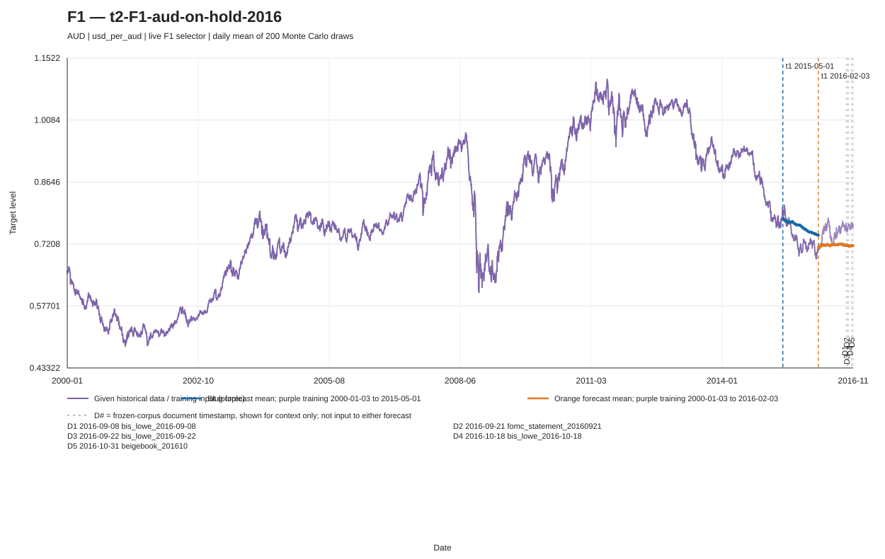
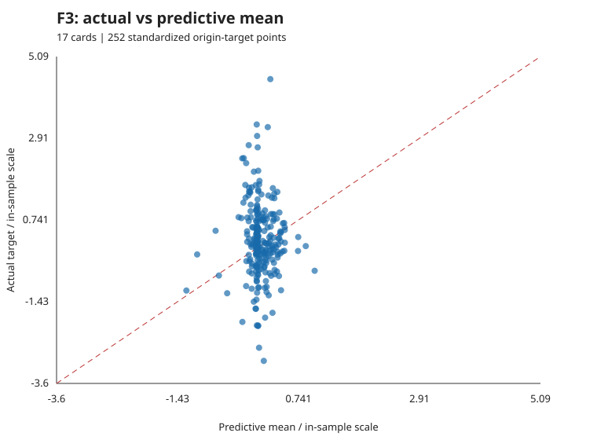

# Results — What We Tested, What We Found, What We Changed

This page summarises every experiment behind the final agent in plain language. Each
section links to the full report, its raw data, and the script that reproduces it.

> **Read this first.** All numbers here come from our own back-tests on historical,
> public market data. They are **not** official competition scores, which are computed
> on sealed outcomes we never saw. They are the evidence we used to make design
> decisions.

---

## How we tested

The competition withholds the real answers, so we built a fair test of our own:

1. Pick a past date and treat it as "today".
2. Give the agent **only** the data available up to that date.
3. Let it forecast, then compare with what actually happened.
4. Repeat across many tasks and several dates, using the same dates and random seeds
   for every method we compare.

**The yardstick.** Each method's score is divided by the score of a plain random walk
("tomorrow ≈ today") on the same task and date:

- **1.00** = exactly as good as the random walk
- **0.90** = 10% lower error (better)
- **1.10** = 10% higher error (worse)

The random walk is a deliberately tough benchmark: in finance, beating it consistently
is genuinely hard.

---

## 1. F1: finding the right trend

**Question:** for "continue this series" tasks, which model works best?

**Experiment A: a head-to-head of nine candidates** across 21 tasks × 4 past dates
([full report](../my_agent_3/testing/README.md#exhaustive-f1-nested-backtest)):

| Model | Score vs random walk | Plain reading |
|---|---:|---|
| Random walk **with trend** | **0.921** | Best overall |
| Historical analogs | 0.942 | Good, but only usable on 60 of 84 dates |
| ARIMA-based model selector | 0.948 | Modestly better than plain ARIMA |
| ARIMA (auto-tuned) | 0.964 | Solid |
| Exponential smoothing | 1.349 | Clearly worse |
| ARIMA with resampled residual blocks | 1.399 | Clearly worse |

**Experiment B: tuning the trend** with 15 window/dampening settings × 3 random seeds
([report](../my_agent_3/testing/F1_DRIFT_GRID_BACKTEST.md)):

- Winner: a **1-year (252 trading-day) trend window, fully dampened**.
- Score **0.896**, about **10% lower error** than the random walk.
- 95% confidence range for the improvement: **4.4% to 16.5%**, so the gain is not luck.

**Decision:** F1 now uses this trend-aware random walk first, with the model selector
as its backup.

  
   <em>F1 example: the Australian dollar in 2016, actual values vs the agent's forecast.</em>

---

## 2. Does each layer earn its place?

**Question:** when we add a layer (volatility, fat tails, copulas), does the forecast
actually improve?

**Set-up:** every task with enough history (**90 tasks, 180 forecasts**), with the
text switched off so that only the numbers are tested
([full report](../my_agent_3/testing/layer_backtest/REPORT.md)).

| Family | Change tested | Result |
|---|---|---|
| F3 (cross-asset) | Copulas vs forecasting each asset separately | Joint-movement error fell by **3.2% (Gaussian)** and **3.8% (Student-t)**; better on 22 of 34 forecasts |
| F3 | Trend-aware baseline | Best F3 baseline: 1.03 vs 1.17 for fixed ARIMA |
| F4 (tail shocks) | Adding fat tails after volatility calibration | Average moved from **1.037 → 0.995**; better on **33 of 58** forecasts and **21 of 29** tasks |
| All | Reliability | Fixed ARIMA failed on 26 of 180 forecasts; the backup model covered every one of them |

**What we learned:**

- Copulas do exactly the job they are meant to do: they improve the "move together"
  part of the score without hurting anything else.
- Fat tails help on crash-risk tasks, but modestly.
- The trend-aware random walk is excellent for F1 and F3 but **not** a universal
  answer. In F1 its median was strong while a few large misses inflated its mean, so
  it sits behind validation rather than being forced everywhere.

  
   <em>Actual outcome vs forecast centre for all F3 tasks. Points near the red diagonal are accurate forecasts.</em>

---

## 3. Making each simulated path hang together

**Problem found:** early versions simulated each forecast horizon independently, so a
single path could jump around unrealistically from one week to the next. That hurt the
"move together" score.

**Fix:** every simulated future is now a complete, coherent path, and every later
layer preserves that path's ordering.

**Result** on the tasks where before/after can be compared
([report](../my_agent_3/testing/README.md#path-coherence-update-and-focused-backtest)):

| Task | Accuracy (CRPS) | Joint movement (variogram) |
|---|---:|---:|
| 2006 Fed pause | −1.2% | **−16.8%** |
| U.S. 2022 bear flattener | +0.2% | **−14.2%** |

The joint-movement error fell sharply while accuracy stayed flat, which is exactly the
intended effect.

---

## 4. Turning news into forecast adjustments

**Question:** once the LLM has read the text and produced its signals, what is the
best way to apply them to the forecast, and what happens when the LLM gets it wrong?

**Set-up** ([full report](../my_agent_3/testing/posterior_benchmark/POSTERIOR_BENCHMARK.md)):
17 methods × 90 tasks × 2 past dates × 5 signal scenarios = **15,300 scored
forecasts**. To measure each method's ceiling, we built a "perfect" signal from the
known answer, then degraded it with 25% noise, 50% noise, and a fully **wrong**
signal. A neutral (no-signal) run checked that every method leaves the forecast
untouched when the text says nothing. (This is a testing device only; it is never used in a real forecast.)

| Method | Perfect signal | 50% noise | Wrong signal | Plain reading |
|---|---:|---:|---:|---|
| **Shift the centre** | **0.822** | **0.849** | 1.347 | Best ceiling and most robust to noise |
| Blend of 3 scenarios | 0.863 | 0.883 | **1.189** | Smallest damage when the LLM is wrong |
| Shift + rescale combined | 0.887 | 0.884 | 1.607 | Strong when right, costly when wrong |
| Rescale only | 1.104 | 1.049 | 1.324 | Weak alone |
| Entropy-pooling re-weighting | 3.214 | 2.986 | 3.284 | Rejected |

**What we learned:**

1. **Direction matters most.** Shifting the centre carries most of the value, and
   moderate noise in *how much* to shift barely matters. Getting the *direction*
   wrong is what hurts.
2. **Sophisticated isn't always better.** The theoretically elegant re-weighting
   approach lost badly. Its resampling step adds noise even when the signal is
   perfect, and it collapses when the signal is wrong.
3. **Text should not touch F1.** The F1 forecast is already strong. Even a perfect
   signal gained less there than elsewhere, several methods made it much worse, and
   a wrong signal always hurt. So F1 stays text-free.
4. **Tail adjustments are cheap insurance:** a small gain with almost no downside.

**Decisions:** keep the bounded, simple adjustments; keep F1 text-free; keep F2's
shift and rescale (best family result: 0.72 with realistic noise). The next
improvements are adding a mean shift to F3 and F4, where the benchmark shows the
biggest untapped gain.

---

## 5. What didn't work, and why that's useful

| Idea | What happened | What we did |
|---|---|---|
| Historical analogs as the main F1 model | Better on some tasks, worse on average, and unavailable on a third of dates | Kept only as a candidate inside the selector |
| Letting the selector pick any model as its anchor | Worse than the conservative version (1.012 vs 0.948) | Reverted |
| ARIMA on log-changes for level series | Worse than the random walk (1.361) | Kept for research only |
| Entropy-pooling text adjustments | Unstable, and very costly when the signal was wrong | Rejected |
| Applying text adjustments to F1 | Small upside at best, large downside when wrong | F1 is text-free |

---

## Limitations

- These are historical back-tests on public data, not the competition's sealed
  evaluation.
- Two to four past dates per task screen methods broadly but cannot pin down
  rare-event (1%) behaviour precisely.
- Scores vary somewhat with random seeds. Where it mattered (the F1 trend grid), we
  used three seeds and confidence intervals.
- The LLM experiments measure the *ceiling* of each method using a perfect signal. A
  real LLM's signals land somewhere between neutral and that ceiling.

---

## Where everything lives

| Experiment | Report | Raw data | Script |
|---|---|---|---|
| Pipeline vs random walk, F1 selector, analogs, path coherence | [testing/README.md](../my_agent_3/testing/README.md) | [f1_nested_backtest.csv](../my_agent_3/testing/f1_nested_backtest.csv) | [run_f1_selector_v2_backtest.py](../my_agent_3/testing/run_f1_selector_v2_backtest.py) |
| F1 trend grid | [F1_DRIFT_GRID_BACKTEST.md](../my_agent_3/testing/F1_DRIFT_GRID_BACKTEST.md) | [f1_drift_grid_backtest.csv](../my_agent_3/testing/f1_drift_grid_backtest.csv) | [run_f1_drift_grid.py](../my_agent_3/testing/run_f1_drift_grid.py) |
| F1 selector promotion check | [F1_SELECTOR_DRIFT_PROMOTION.md](../my_agent_3/testing/F1_SELECTOR_DRIFT_PROMOTION.md) | [f1_selector_drift_promo.csv](../my_agent_3/testing/f1_selector_drift_promo.csv) | [run_f1_selector_drift_promo.py](../my_agent_3/testing/run_f1_selector_drift_promo.py) |
| F1 selector v2 | [F1_SELECTOR_V2_BACKTEST.md](../my_agent_3/testing/F1_SELECTOR_V2_BACKTEST.md) | [f1_selector_v2_backtest.csv](../my_agent_3/testing/f1_selector_v2_backtest.csv) | [run_f1_selector_v2_backtest.py](../my_agent_3/testing/run_f1_selector_v2_backtest.py) |
| Layer-by-layer, all families | [layer_backtest/REPORT.md](../my_agent_3/testing/layer_backtest/REPORT.md) | [all_card_origin_scores.csv](../my_agent_3/testing/layer_backtest/all_card_origin_scores.csv) | [run_layer_backtest.py](../my_agent_3/testing/run_layer_backtest.py) |
| Text-adjustment methods | [POSTERIOR_BENCHMARK.md](../my_agent_3/testing/posterior_benchmark/POSTERIOR_BENCHMARK.md) | [posterior_scores.csv](../my_agent_3/testing/posterior_benchmark/posterior_scores.csv) | [run_posterior_benchmark.py](../my_agent_3/testing/run_posterior_benchmark.py) |
| Example forecast charts | [representative_family_charts](../my_agent_3/testing/representative_family_charts/README.md), [f1_daily_pipeline_charts](../my_agent_3/testing/f1_daily_pipeline_charts/README.md) | — | [plot_representative_forecasts.py](../my_agent_3/testing/plot_representative_forecasts.py) |
| Per-family production search | `f1`–`f4_production_search_backtest/` folders | `all_card_origin_scores.csv` in each | — |
