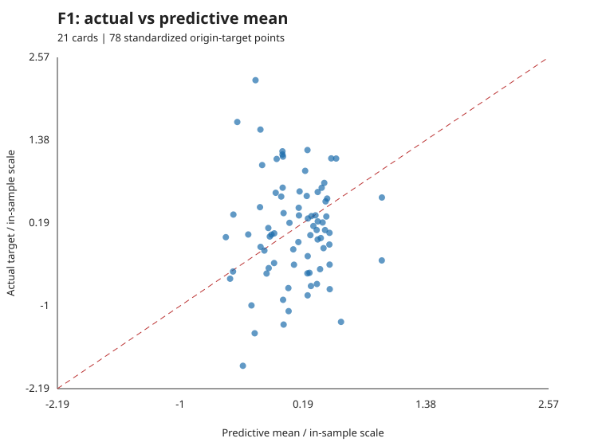
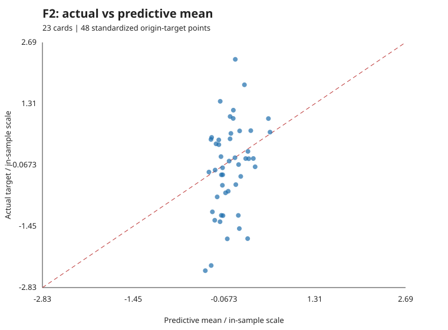
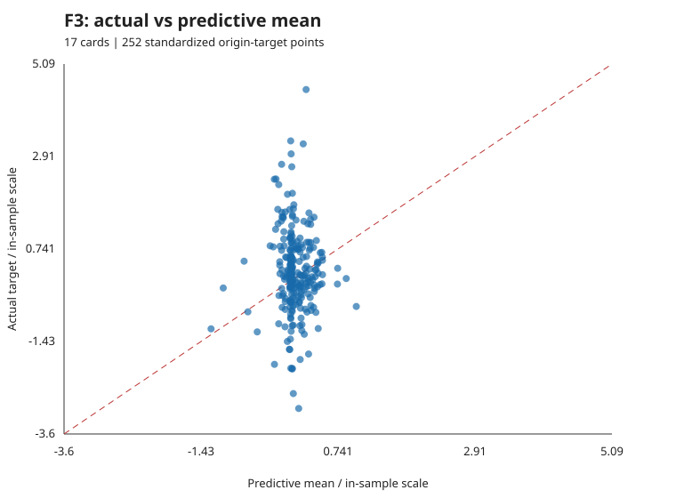
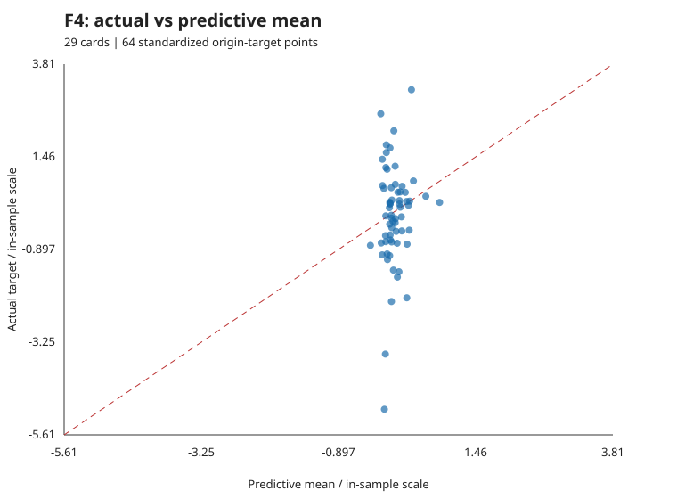

# Layer 1–3 improvements and exhaustive numerical backtest

## Scope and protocol

This run covers every authored card with two complete, non-overlapping rolling forecast windows. Each forecast fits on panel data from the card’s first available target observation (`t0`) through its cutoff (`t1`), then predicts the target window ending at `t2`. The future panel is used only to obtain realized targets. The frozen text corpus was never loaded: **zero documents were introduced or used between `t0` and `t2`, or at any other point in this numerical evaluation.**

Each forecast used 200 draws. The Layer 1 comparison uses fixed ARIMA(1,0,1), following the project’s faster backtest convention, with ETS fallback when that fit fails (26 of 180 origins). It compares this ARIMA/ETS baseline against local-drift random walk and plain random walk. Layer 2 compares a bounded, shrunk EWMA/GARCH volatility adjustment; `arch` is unavailable in the current Python environment, so the tested Layer 2 path used its EWMA fallback. Layer 3 compares independent marginals with Gaussian and Student-t copulas, holding the same marginal draws fixed. F4 also tests the Student-t marginal tail transform.

**Metric:** each card-origin weighted CRPS/variogram/tail composite is divided by the plain random-walk composite for that same card and origin. Random walk is therefore 1.0; lower is better. These are local relative scores, not the organizer’s normalized competition score. For one-cell cards, the variogram term is zero and the active components renormalize. The “wins” column counts origins with relative composite below 1.0. Raw mean CRPS and tail columns are descriptive only because cards have different units; compare relative composites within this backtest instead.

## Coverage

- Authored cards: 104; backtested: 90; insufficient complete windows: 14.
- Backtest origins: 180; every scored card has two origins; fit/score failures after fallback: 0.
- Family coverage: 21/23 F1, 23/27 F2, 17/23 F3, and 29/31 F4 cards.
- A single fixed order is used for the outer ARIMA benchmark; production still uses its existing ARIMA candidate search and F1 past-only selector. This report therefore isolates layer behavior and should not be read as a full production-pipeline score. The live F1 selector is not run in this sweep; its conditional local-drift anchor still needs a separate nested comparison against the prior selector.

## Results by family

### T2-F1

| Variant | Origin forecasts | Mean relative composite | Median | Better than RW | Mean CRPS | Mean tail loss |
|---|---:|---:|---:|---:|---:|---:|
| layer1_arima_fixed | 42 | 1.1455 | 0.9532 | 22/42 | 0.3427 | 0.0572 |
| layer1_local_drift | 42 | 1.8174 | 0.8664 | 24/42 | 0.3785 | 0.0580 |
| random_walk | 42 | 1.0000 | 1.0000 | 0/42 | 0.3703 | 0.0514 |

### T2-F2

| Variant | Origin forecasts | Mean relative composite | Median | Better than RW | Mean CRPS | Mean tail loss |
|---|---:|---:|---:|---:|---:|---:|
| layer1_arima_fixed | 46 | 1.0205 | 0.9409 | 28/46 | 0.4779 | 0.0671 |
| layer1_local_drift | 46 | 1.1320 | 0.9631 | 24/46 | 0.6561 | 0.0783 |
| random_walk | 46 | 1.0000 | 1.0000 | 0/46 | 0.5319 | 0.0671 |

### T2-F3

| Variant | Origin forecasts | Mean relative composite | Median | Better than RW | Mean CRPS | Mean tail loss |
|---|---:|---:|---:|---:|---:|---:|
| layer1_arima_fixed | 34 | 1.1691 | 1.0596 | 14/34 | 0.3250 | 0.0865 |
| layer1_local_drift | 34 | 1.0287 | 0.9508 | 22/34 | 0.2827 | 0.0399 |
| random_walk | 34 | 1.0000 | 1.0000 | 0/34 | 0.3008 | 0.0421 |
| layer2_garch_shrunk | 34 | 1.0072 | 0.9927 | 18/34 | 0.2928 | 0.0370 |
| layer3_independent | 34 | 1.0072 | 0.9927 | 18/34 | 0.2928 | 0.0370 |
| layer3_gaussian | 34 | 0.9858 | 0.9335 | 19/34 | 0.2928 | 0.0370 |
| layer3_student_t | 34 | 0.9839 | 0.9343 | 19/34 | 0.2928 | 0.0370 |

### T2-F4

| Variant | Origin forecasts | Mean relative composite | Median | Better than RW | Mean CRPS | Mean tail loss |
|---|---:|---:|---:|---:|---:|---:|
| layer1_arima_fixed | 58 | 1.0659 | 1.0076 | 26/58 | 0.3738 | 0.0707 |
| layer1_local_drift | 58 | 1.1496 | 0.9453 | 32/58 | 0.3963 | 0.0757 |
| random_walk | 58 | 1.0000 | 1.0000 | 0/58 | 0.3865 | 0.0749 |
| layer2_garch_shrunk | 58 | 1.0369 | 1.0010 | 28/58 | 0.3665 | 0.0620 |
| layer2_garch_plus_student_t | 58 | 0.9945 | 0.9629 | 36/58 | 0.3717 | 0.0623 |

## Paired layer comparisons

Comparisons below use identical card-origin windows. A negative mean difference indicates lower relative composite for the named change.

| Family | Comparison | Matched origins | Mean difference | Improved origins | Card means improved |
|---|---|---:|---:|---:|---:|
| F1 | local drift vs ARIMA/ETS baseline | 42 | +0.6719 | 23/42 | 11/21 |
| F2 | local drift vs ARIMA/ETS baseline | 46 | +0.1115 | 21/46 | 10/23 |
| F3 | local drift vs ARIMA/ETS baseline | 34 | -0.1404 | 21/34 | 12/17 |
| F4 | local drift vs ARIMA/ETS baseline | 58 | +0.0837 | 36/58 | 14/29 |
| F3 | shrunk EWMA vs ARIMA/ETS baseline | 34 | -0.1618 | 21/34 | 11/17 |
| F3 | Gaussian copula vs independent | 34 | -0.0214 | 22/34 | 11/17 |
| F3 | Student-t copula vs independent | 34 | -0.0233 | 21/34 | 10/17 |
| F4 | Student-t marginal vs shrunk EWMA | 58 | -0.0424 | 33/58 | 21/29 |

For F3, both copulas leave marginal CRPS and tail scores unchanged while lowering variogram loss. Mean variogram ratios versus independent draws were 0.968 for Gaussian and 0.962 for Student-t, so the dependence improvement is visible in the score component it is meant to address. The two copulas are close on this sample.

For F4, the marginal Student-t transform added after shrunk volatility calibration improved the paired composite on 33/58 origins and 21/29 card averages. It reduced mean relative composite from 1.0369 to 0.9945. The EWMA/GARCH volatility adjustment by itself was near the random-walk reference (1.0369).

Layer 1 drift is not a universal replacement for the ARIMA/ETS benchmark. It performed best in F3 (mean 1.0287 versus baseline 1.1691), but not on pooled mean composite in F1, F2, or F4. In F1, drift’s median relative composite was better (0.8664 vs 0.9532) while its mean was much worse (1.8174), indicating a few large misses. Keep drift as a validation-gated candidate rather than making it a universal default.

## Actual target vs predictive mean plots

Each chart pools the Layer 1 baseline predictive mean from 200 draws against the realized target across all eligible cards and both origins in that family. To compare heterogeneous units, level targets are centered at the last observation at `t1`; log-return targets are centered at zero. Both axes are divided by the in-sample one-step innovation standard deviation times the square root of the forecast step. The baseline uses fixed ARIMA(1,0,1), with ETS fallback on fit failure. The red diagonal is perfect mean prediction.

*F1: 21 cards and 78 standardized target-origin points.*

*F2: 23 cards and 48 standardized target-origin points.*

*F3: 17 cards and 252 standardized target-origin points.*

*F4: 29 cards and 64 standardized target-origin points.*

## Cards excluded

The following 14 cards did not have two complete, non-overlapping windows at the minimum training history:

- `t2-F1-cpi-glidepath-2023` — no complete rolling origins
- `t2-F1-sahm-watch-2024` — no complete rolling origins
- `t2-F2-cnh-stress-2015` — no complete rolling origins
- `t2-F2-cnh-tradewar-2018` — no complete rolling origins
- `t2-F2-fragile-five-brl-2013` — no complete rolling origins
- `t2-F2-fragile-five-inr-2013` — no complete rolling origins
- `t2-F3-boj-ust-channel-2023` — no complete rolling origins
- `t2-F3-divergence-2014` — no complete rolling origins
- `t2-F3-dollar-vortex-2022` — no complete rolling origins
- `t2-F3-election-2024-joint` — no complete rolling origins
- `t2-F3-fragile-five-joint-2013` — no complete rolling origins
- `t2-F3-safe-haven-paradox-2011` — no complete rolling origins
- `t2-F4-covid-nfp-2020` — no complete rolling origins
- `t2-F4-cpi-vintage-2022` — no complete rolling origins

## Interpretation and next steps

1. Keep local drift behind rolling validation, and continue evaluating it by card; the aggregate evidence is mixed and F1 has a large-mean-loss tail.
2. Retain bounded volatility calibration as an optional Layer 2 component. This run tested EWMA because `arch` is absent; repeat with the Docker image’s actual `arch` dependency before claiming GARCH-specific gains.
3. Retain copulas for F3. Both versions improve joint variogram relative to independent draws; Student-t has only a small advantage over Gaussian here.
4. Keep F4’s Student-t marginal adjustment under evaluation: it improved relative composite in this sample, but the effect is modest and should be checked on sealed competition data.
5. Use the four SVGs and the raw CSV for card-level inspection. Origin results are paired but not independent across cards or assets, and historical public-panel results cannot reproduce sealed organizer scores.

## Artifacts

- Raw origin/variant scores, realized targets, and draw means: [all_card_origin_scores.csv](all_card_origin_scores.csv)
- Machine-readable run metadata and exclusions: [run_manifest.json](run_manifest.json)
- Reproduction: `python3 my_agent_3/testing/run_layer_backtest.py --origins 2 --draws 200`
- Script fixes the information cutoff at each `t1`; no corpus path is read by the backtest.

## Follow-up: representative value timelines with text release markers

For a view of forecast means in the original target units, see [`representative_family_charts/README.md`](../representative_family_charts/README.md). Each chart overlays actual values and two rolling forecast-mean paths for one representative card per family. Vertical dashed lines mark release timestamps from the corpus index; text was not provided to the numerical forecasts. The F3 example is a 10-year yield level, while F1/F2/F4 examples are currency levels.
